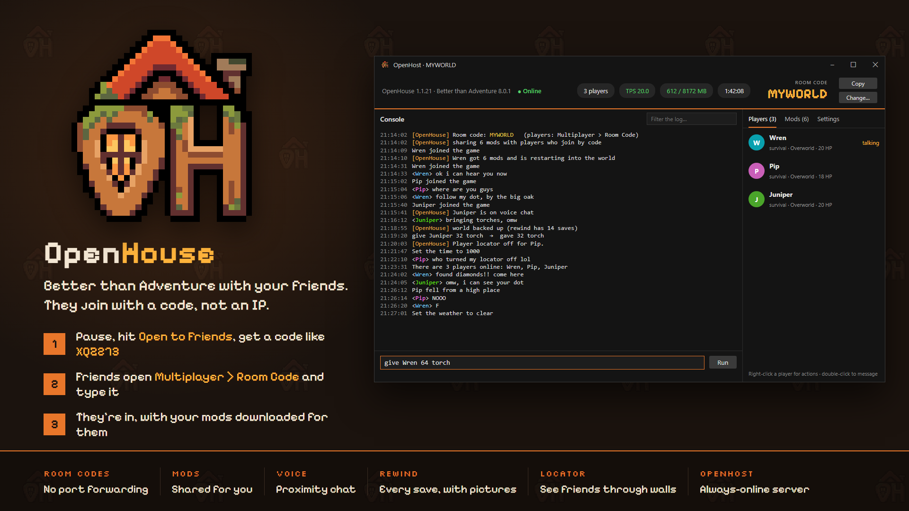
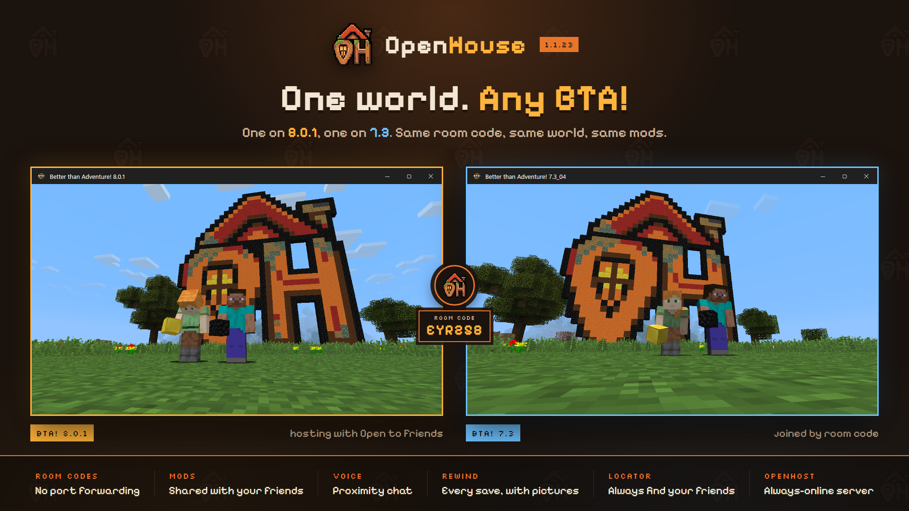

# OpenHouse (OH)

Easily launch a BTA! server for you and your friends, zero port forwarding.

- **Room codes.** Open any world to friends from the pause menu and share a short code. No IP, no port forwarding.
- **Mods come with you.** Friends who join download your mods and texture packs by themselves.
- **Voice chat.** Talk to whoever's nearby, plus your own custom hurt sounds.
- **Rewind.** Every save of your world on a timeline with pictures. Load an old one without touching the real world.
- **Player locator.** Friends' names show through walls in their own colour, and as dots when they're far away.
- **OpenHost.** An always-online server with a proper window: players, mods, settings and a console that understands lazy commands.
- **AFK players fade out.** Tab out or go idle and you slowly fade away, then make room after a while. Mobs leave you alone meanwhile.
- **Plays nice.** Joins from Better than Adventure 8.0.1 or 7.3, the helper, or [Rocket Edition](https://mcrocket.lol) in a browser.

## Which download do I need?

| I want to... | Get this |
|---|---|
| Play with friends, the easy way | **[OpenHouse BTA Instance](https://github.com/colinthepwner/OpenHouse-bta/releases/latest/download/OpenHouse-BTA-Instance.zip)**, for Prism Launcher or MultiMC. Click **Add Instance**, then **Import**, and pick the zip. |
| Add OpenHouse to the BTA! I already play | The mod, `openhouse-<version>.jar` from [Releases](https://github.com/colinthepwner/OpenHouse-bta/releases/latest). It goes in your `mods` folder (needs Babric). The same file works on BTA! 8.0.1 and 7.3. |
| Run a server that's always online | **[OpenHost.jar](https://github.com/colinthepwner/OpenHouse-bta/releases/latest/download/OpenHost.jar)** |
| Join or host without a mod loader | **[openhouse-helper.jar](https://github.com/colinthepwner/OpenHouse-bta/releases/latest/download/openhouse-helper.jar)** (see [No mod loader?](#no-mod-loader)) |

# Ad Hoc
This method lets you run a temporary server from any singleplayer world.\
If you just want a quick session with your friends, this is the simplest way.

Step by step:

- Launch the game with the mod loaded, or use the [instance](https://github.com/colinthepwner/OpenHouse-bta/releases/latest/download/OpenHouse-BTA-Instance.zip) (Prism Launcher or MultiMC).
- Create or join a singleplayer world.
- Press ESC, then click "Open to friends".
- Wait while everything loads.
- You will be given a room code that your friends must enter in the multiplayer menu.
- You can copy and paste the room code from the ESC menu.
- Shift-click the room code to give the room a password, right-click it to pick your own code.
- Closing the world will shut down the room and save your progress.

Make sure everyone trying to connect is using the mod, and things should just work.\
Your friends see as far as your render distance lets you.

You can load additional mods by simply adding mod.jar to your minecraft/mods folder before loading the world.\
Only the host needs to worry about adding mods; connecting friends automatically download the mods they need.\
Texture packs you have turned on go to your friends too, ready for them to turn on if they like.

# Always Online Server
OpenHost.jar works as an alternative to the BTA! server.jar, with a more pleasant frontend.\
If you need a server running even when you're not playing, this is the best method.

**Connecting clients still need the mod or the instance loaded to join your OpenHost server.**\
Everything can be found in [Releases](https://github.com/colinthepwner/OpenHouse-bta/releases/latest).

Just place OpenHost.jar in a folder and double-click it; the rest should be self-explanatory.

- The room code is new every time the server starts. To keep one, type `oh set MYWORLD` in the
  console (6 to 16 letters or digits). If another server already uses it, OpenHost tells you.
- Mods go in its `mods` folder like on any server, and players who join get them.
- Texture packs go in its `texturepacks` folder. Players who join get them, switched off until
  they pick them.
- Already have a BTA! 8.0.1 server? Put OpenHost.jar in its folder. It uses that server's world,
  settings and mods, and leaves them working for the old server too. Don't run both at once.
- Its Settings tab sets a password, a whitelist and the server's memory.
- Prefer BTA!'s classic server window, or none at all? Set `openhost-ui` to `classic` or
  `console` in `server.properties`.
- Needs Java 17 or newer. OpenHost keeps itself up to date.

# Joining
- Load the mod or the [instance](https://github.com/colinthepwner/OpenHouse-bta/releases/latest/download/OpenHouse-BTA-Instance.zip).
- Go to **Multiplayer**, pick **Room Code**, type the code and click **Join**.
- On the same network? Worlds and servers with OpenHouse show up under **Local Network** too. Just
  click one.
- If the host has mods you don't, OH offers to grab them and restart the game with them. Your own
  `mods` folder stays the way it was. Only take mods from people you trust.
- Tick **Keep the mods in my folder** to play with your own mods too, next to the host's. If you
  both have the same mod, the host's is used.
- The host's texture packs land in your texture pack list, switched off.
- Some mods need a file from the original mod they were ported from. If the host has it, you get
  it too.

# Voice chat
Talk to the players near you, the closer they are the louder they sound. It works with Minecraft
Rocket Edition players too.

- It's on by default. Just talk. **M** mutes you.
- The mic button in the pause menu has the settings: your microphone, volume, push to talk, and
  Hear Myself to check how you sound.
- Game sounds, music and other players coming out of your speakers are kept out of your mic.
- The music turns down a little while someone nearby is talking.
- **Voice Chat** volume is also under Options > Audio.
- `/mute <player>` and `/unmute <player>` are just for you. Ops can mute someone for everyone with
  `/mute <player> @a`.
- Gamerule `mobsHearVoice` (off by default) lets monsters hear you talking.
- The mic in the corner only shows up when someone else is around to hear you.
- Have e4BTA Voice too? It steps aside wherever OpenHouse voice is running, so nobody hears you twice.

## Custom hurt sound
Options > Player > Hurt Sound has a **Custom** setting with a mic button next to it.

- Hold the button to record, or click it and say something.
- Right-click it to use sound files instead (`.wav`, `.mp3`, `.ogg` or `.opus`). Pick up to 3 and
  one of them plays each time.
- Only a short sound is kept, evened out so it's never too loud or too quiet. Everyone with
  OpenHouse or Rocket Edition hears it when you get hurt, and when you die.
- Name one of the files `death` (`death.wav`, say) and it plays when you die instead.

# Rewind
The rewind button next to the folder in your world list shows your world's saves on a timeline,
with a picture of each.

- **Play** opens your world like normal.
- An older save opens as a copy. Your world doesn't change while you play it.
- In the copy's pause menu, **Return to Timeline** throws the copy away. **Replace World** makes it
  your world, and asks first.
- Your world as it was stays on the timeline, so you can go back.
- Saves are kept as you play: every time you leave a world, and around Open to Friends.

# Passwords and whitelists
- `/oh password <password>` in your opened world or the server console. Friends type it once when
  they join. `/oh password off` removes it.
- `/oh whitelist on`, then `/oh whitelist add <name>` lets in only the players you list. It goes by
  name, so use a password if it really matters.
- Players without the mod can't join a world or server that has a password.

# No mod loader?
`openhouse-helper.jar` works with any BTA! version, no Fabric needed:

- To join: run `java -jar openhouse-helper.jar join K7QXD`, then Direct Connect to the address it
  shows. You can also just double-click it.
- To host: start your server, then run `java -jar openhouse-helper.jar host` in its folder. For a
  code that stays the same, add the address and your own: `host localhost:25565 MYWORLD`.

The helper doesn't hand out mods, so everyone needs the same ones.

## Good to know

- OpenHouse can be added to your existing Babric server: put the mod in its `mods` folder and
  type `/oh` in the console for the code.
- Everyone in a world needs a matching version of OpenHouse. Close versions usually work together,
  and when they don't, OH tells you and can update itself with one click. Small updates wait until
  a few have piled up, so you aren't asked every time.
- Friends can join with or without a Minecraft account. Without one, they show up with the skin
  that goes with their name.
- Two people can't play under the same name at once.
- Players on BTA! 7.3 and 8.0.1 can play in the same world. Join like always.
- Players who tab out, sit on the pause menu or stop touching the keys for a minute fade away, and are
  disconnected after 2 minutes (never the host). Mobs ignore them until they're back. Hosts change it with
  `/oh afk idle <seconds>`, `/oh afk kick <seconds>` (0 for never) and the game rules `afkFade` and
  `afkMobsIgnore`.
- Two mods that want the same block or item number don't stop the game. OH moves one and keeps it there.
- Your friends' names show through walls in their own colour (the same one their name has in chat), and turn into a dot when they're far
  away, so you can always find each other. Sneaking hides you behind walls. Turn it off in
  Options > Player. Hosts can turn it off for everyone (`/gamerule showPlayerLocator false`) or
  for some players (`/oh locator off <players>`, `@a` works).
- Your world gets backed up when you leave it, before and after you open it to friends, and once
  a day. The backups are in `openhouse/backups` and on the rewind timeline. If something in a world
  gets broken, OH fixes it the next time you open the world.
- A mod that's missing for a while doesn't take its blocks, chests and items with it. They stay in
  your world and come back when the mod does.
- Mods that only work in the game stay out of your world's server by themselves, and friends get
  your mod settings along with your mods.
- If a mod crashes your open world, OH tells you which one, and keeps it out of the server next
  time if it only belongs in your own game.
- A folder a mod keeps beside the game (BTEmu's `roms`, say) goes to your world's server, and
  players can add their own, so everyone can use what anyone brought. `share-folders` in
  `openhouse.properties` names the folders (`roms` by default, `off` for none).
- With BTA's Discord presence on, click your room code in the pause menu to show it on your
  Discord profile so friends can press Join.
- The first time you use it, it downloads a couple of things it needs.
- Some school, work and phone networks block this kind of connection.
- If codes stop working for everybody at once, the free matchmaking service it uses is probably
  down. Try again later.

## Building

`sh build.sh` builds the helper. `sh mod/build.sh` builds the mod and `OpenHost.jar` (needs JDK 21).
