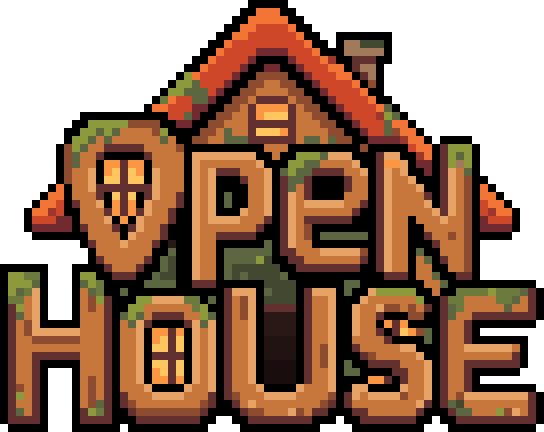

# OpenHouse (OH)

Easily launch a BTA! server for you and your friends, zero port forwarding.

## Which download do I need?

| I want to... | Get this |
|---|---|
| Play with friends, the easy way | **[OpenHouse BTA Instance](https://github.com/colinthepwner/OpenHouse-bta/releases/latest/download/OpenHouse-BTA-Instance.zip)**, for Prism Launcher or MultiMC. Click **Add Instance**, then **Import**, and pick the zip. |
| Add OpenHouse to the BTA! I already play | The mod, `openhouse-<version>.jar` from [Releases](https://github.com/colinthepwner/OpenHouse-bta/releases/latest). It goes in your `mods` folder (needs Babric). |
| Run a server that's always online | **[OpenHost.jar](https://github.com/colinthepwner/OpenHouse-bta/releases/latest/download/OpenHost.jar)** |
| Join or host without a mod loader | **[openhouse-helper.jar](https://github.com/colinthepwner/OpenHouse-bta/releases/latest/download/openhouse-helper.jar)** (see [No mod loader?](#no-mod-loader)) |

# Ad Hoc
This method lets you run a temporary server from any singleplayer world.\
If you just want a quick session with your friends, this is the simplest way.

Step by step:

- Launch the game with the mod loaded, or use the [instance](https://github.com/colinthepwner/OpenHouse-bta/releases/latest/download/OpenHouse-BTA-Instance.zip) (Prism Launcher or MultiMC).
- Create or join a singleplayer world.
- Press ESC, then click "Open to friends".
- Wait while everything loads.
- You will be given a room code that your friends must enter in the multiplayer menu.
- You can copy and paste the room code from the ESC menu.
- Closing the world will shut down the room and save your progress.

Make sure everyone trying to connect is using the mod, and things should just work.

You can load additional mods by simply adding mod.jar to your minecraft/mods folder before loading the world.\
Only the host needs to worry about adding mods; connecting friends automatically download the mods they need.

# Always Online Server
OpenHost.jar works as an alternative to the BTA! server.jar, with a more pleasant frontend.\
If you need a server running even when you're not playing, this is the best method.

**Connecting clients still need the mod or the instance loaded to join your OpenHost server.**\
Everything can be found in [Releases](https://github.com/colinthepwner/OpenHouse-bta/releases/latest).

Just place OpenHost.jar in a folder and double-click it; the rest should be self-explanatory.

- The room code is new every time the server starts. To keep one, type `oh set MYWORLD` in the
  console (6 to 16 letters or digits). If another server already uses it, OpenHost tells you.
- Mods go in its `mods` folder like on any server, and players who join get them.
- Its Settings tab sets a password, a whitelist and the server's memory.
- Prefer BTA!'s classic server window, or none at all? Set `openhost-ui` to `classic` or
  `console` in `server.properties`.
- Needs Java 17 or newer. OpenHost keeps itself up to date.

# Joining
- Load the mod or the [instance](https://github.com/colinthepwner/OpenHouse-bta/releases/latest/download/OpenHouse-BTA-Instance.zip).
- Go to **Multiplayer**, pick **Room Code**, type the code and click **Join**.
- If the host has mods you don't, OH offers to grab them and restart the game with them. Your own
  `mods` folder stays the way it was. Only take mods from people you trust.

# Passwords and whitelists
- `/oh password <password>` in your opened world or the server console. Friends type it once when
  they join. `/oh password off` removes it.
- `/oh whitelist on`, then `/oh whitelist add <name>` lets in only the players you list. It goes by
  name, so use a password if it really matters.
- Players without the mod can't join a world or server that has a password.

# No mod loader?
`openhouse-helper.jar` works with any BTA! version, no Fabric needed:

- To join: run `java -jar openhouse-helper.jar join K7QXD`, then Direct Connect to the address it
  shows. You can also just double-click it.
- To host: start your server, then run `java -jar openhouse-helper.jar host` in its folder. For a
  code that stays the same, add the address and your own: `host localhost:25565 MYWORLD`.

The helper doesn't hand out mods, so everyone needs the same ones.

## Good to know

- OpenHouse can be added to your existing Babric server: put the mod in its `mods` folder and
  type `/oh` in the console for the code.
- Everyone in a world needs the same version of OpenHouse. When a new one is out, OH tells you
  and can update itself with one click.
- Friends can join with or without a Minecraft account. Without one, they show up with the skin
  that goes with their name.
- Two people can't play under the same name at once.
- Mods that only work in the game stay out of your world's server by themselves, and friends get
  your mod settings along with your mods.
- If a mod crashes your open world, OH tells you which one.
- With BTA's Discord presence on, click your room code in the pause menu to show it on your
  Discord profile so friends can press Join.
- The first time you use it, it downloads a couple of things it needs.
- Some school, work and phone networks block this kind of connection.
- If codes stop working for everybody at once, the free matchmaking service it uses is probably
  down. Try again later.

## Building

`sh build.sh` builds the helper. `sh mod/build.sh` builds the mod and `OpenHost.jar` (needs JDK 21).
