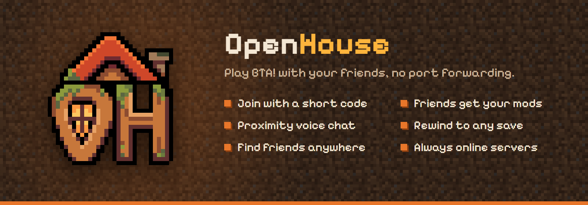

**OpenHouse** easily launches a Better than Adventure (BTA!) server for you and your friends, zero port forwarding. No Hamachi, playit.gg or ngrok, just a room code.

## Download

| I want to... | Get this |
|---|---|
| Play with friends, the easy way | **[OpenHouse BTA Instance](https://github.com/colinthepwner/OpenHouse-bta/releases/latest/download/OpenHouse-BTA-Instance.zip)** for Prism Launcher or MultiMC (Add Instance, then Import) |
| Add it to the BTA! I already play | The `openhouse` jar from **[Releases](https://github.com/colinthepwner/OpenHouse-bta/releases/latest)**, into your `mods` folder |
| Run a server that's always on | **[OpenHost.jar](https://github.com/colinthepwner/OpenHouse-bta/releases/latest/download/OpenHost.jar)** |
| Play without a mod loader | **[openhouse-helper.jar](https://github.com/colinthepwner/OpenHouse-bta/releases/latest/download/openhouse-helper.jar)** |

Works on BTA! 8.0.1 and 7.3, and players on both can share a world.

# Ad Hoc

Host from any singleplayer world.

1. Open your world and press **ESC**.
2. Click **Open to friends**.
3. Send your friends the room code.

Close the world to end the room. Add mods to your `mods` folder and friends get them when they join. Rooms hold up to 9 players.

# Always Online Server

Put **OpenHost.jar** in a folder and double click it. That's it.

Or pick a world in your world list and click the server button to move it to OpenHost. It shows in your list in orange, and clicking it starts the server and joins it.

- Mods go in its `mods` folder, texture packs in `texturepacks`.
- Type `oh set MYWORLD` in the console to keep the same code.
- Already have a BTA! 8.0.1 server? Drop OpenHost.jar into its folder.
- Needs Java 17 or newer. It keeps itself updated.

# Joining

1. Open **Multiplayer** and pick **Room Code**.
2. Type the code and click **Join**.

If the host has mods you don't, OpenHouse offers to grab them for you. Only join people you trust.

<b>Voice chat</b>

- On by default. Press **M** to mute.
- Settings are on the mic button in the pause menu.
- Options > Player > Hurt Sound lets you record your own hurt sound.
- `/mute <player>` mutes someone just for you.

<b>Rewind</b>

Click the rewind button next to a world in your world list. Pick any save to play a copy of it, or make it your world again.

<b>Passwords and whitelists</b>

- `/oh password <password>` adds a password. `/oh password off` removes it.
- `/oh whitelist on`, then `/oh whitelist add <name>`.

<b>No mod loader</b>

- Join: `java -jar openhouse-helper.jar join <code>`, then Direct Connect to the address it shows.
- Host: start your server, then run `java -jar openhouse-helper.jar host` in its folder.

Everyone needs the same mods, since the helper doesn't share them.

<b>Good to know</b>

- Add the mod to an existing Babric server and type `/oh` for its code.
- Everyone needs a matching OpenHouse version. It offers to update itself when needed.
- Friends can join with or without a Minecraft account.
- Idle players fade out and mobs leave them alone.
- Your worlds are backed up in `openhouse/backups`.
- Some school, work and phone networks block these connections.

## Building

`sh build.sh` builds the helper. `sh mod/build.sh` builds the mod and OpenHost (JDK 21).
