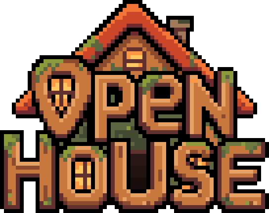

# OpenHouse (OH)

Play Better than Adventure with your friends using a five-letter code. No port forwarding, no IP
addresses, and your friends get your mods automatically.

Made for BTA 8.0.1 with Babric/Fabric.

## Playing with friends

1. Put the mod in your `mods` folder and open a single-player world.
2. Press Esc and click **Open to Friends**.
3. Your room code shows up in chat. Send it to your friends.

When you're done, press Esc and click **Close World**. Everything's saved, and you can keep
playing the world on your own.

## Joining a friend

1. Put the mod in your `mods` folder.
2. Go to **Multiplayer**, pick **Room Code**, type the code and click **Join**.

If your friend has mods you don't, OH offers to grab them and restart the game with them. Your
own `mods` folder stays the way it was. Only take mods from people you trust.

## Servers

Put the mod in a Babric server's `mods` folder. The room code shows up in the console and stays
the same every time the server starts. Type `/oh` to see it. Ops can also use `/oh new`,
`/oh set <code>`, `/oh on` and `/oh off`.

The server keeps OpenHouse up to date by itself; a new version goes in the next time it restarts.

## No mod loader?

`openhouse-helper.jar` works with any BTA version, no Fabric needed:

- To join: run `java -jar openhouse-helper.jar join K7QXD`, then Direct Connect to the address
  it shows. You can also just double-click it.
- To host: start your server, then run `java -jar openhouse-helper.jar host` in its folder.

The helper doesn't hand out mods, so everyone needs the same ones. It updates itself when a new
version is out.

## Good to know

- Everyone in a world needs the same version of OpenHouse. When a new one is out, OH tells you
  and can update itself with one click.
- Friends can join with or without a Minecraft account. Without one, they show up with the skin
  that goes with their name.
- Two people can't play under the same name at once.
- Mods that only work in the game stay out of your world's server by themselves, and friends get
  your mod settings along with your mods.
- With BTA's Discord presence on, click your room code in the pause menu to show it on your
  Discord profile so friends can press Join.
- The first time you use it, it downloads a couple of things it needs.
- Some school, work and phone networks block this kind of connection.
- If codes stop working for everybody at once, the free matchmaking service it uses is probably
  down. Try again later.

## Building

`sh build.sh` builds the helper. `sh mod/build.sh` builds the mod (needs JDK 21).
